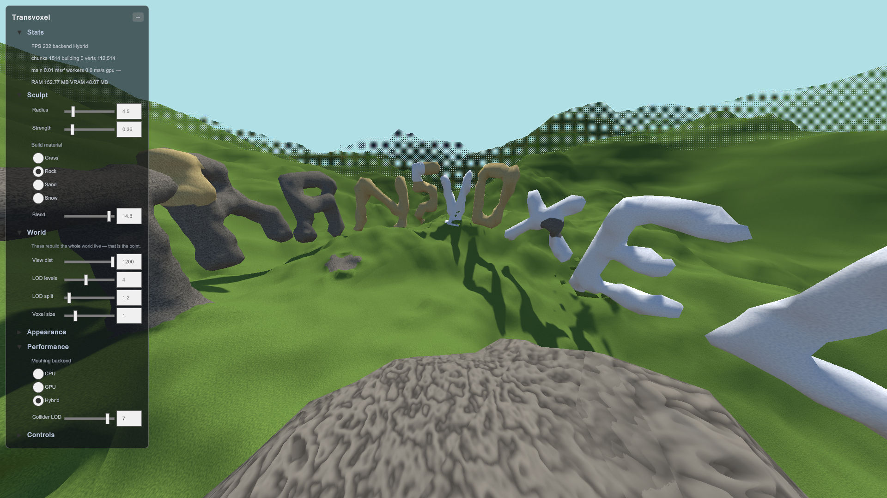

### About Transvoxel

Seamless level-of-detail voxel terrain for Unity: Eric Lengyel's Transvoxel algorithm on an octree, built for large, editable, real-time landscapes.

An octree decides which chunks exist around the viewer, and Transvoxel transition cells stitch every seam between neighbouring levels of detail, so the surface stays watertight at any distance. Chunks mesh on CPU worker threads, on the GPU with compute shaders, or on both at once, and every change, from a LOD swap to a terraform stroke, dithers in without popping.

Players dig and build into a sparse edit layer over the procedural landscape, painting voxels with blended materials that still render as one material with full SRP batching. Density, meshing, octree and orchestration are separate layers behind small interfaces, written to be read and replaced one at a time.



<table>
  <tr>
    <td></td>
    <td></td>
  </tr>
</table>

### Features

1. Seamless, crack-free LOD transitions
2. Real-time digging and building
3. Octree streaming for huge landscapes
4. CPU, GPU compute or hybrid meshing
5. Flat frame rate at any flight speed
6. Pop-free dithered cross-fades
7. Up to 64 blended voxel materials
8. Triplanar and parallax occlusion
9. Every setting applies live in Play mode
10. Smooth or flat low-poly shading
11. Swappable density, meshing and octree
12. Live CPU, GPU, RAM and VRAM stats

Detailed about features - see [FEATURES.md](Documentation/FEATURES.md). How the package is tested - see [TESTING.md](Documentation/TESTING.md).

### Performance

**Every per-frame cost is bounded.** Sampling, meshing, octree selection and collider baking run on worker threads or the GPU. The main thread only diffs the chunk set and uploads finished meshes within a time budget, 3 ms by default, so flying, sprinting or teleporting never freezes a frame: unbuilt terrain fills in nearest-first instead.

**Distance costs little.** Coarse levels of detail sample only their own lattice points, chunk objects and meshes are pooled rather than created, and fades animate in the shader from baked vertex data at no CPU cost. **Window ▸ Transvoxel ▸ Terrain Stats** shows the terrain's own CPU, GPU, RAM and VRAM cost live on your hardware.

Detailed about performance - see [PERFORMANCE.md](Documentation/PERFORMANCE.md).

### Requirements

1. Unity 6.2 or newer.
2. URP 17 or newer, installed as a dependency.
3. Unity Test Framework, which new projects include.
4. Compute shaders for GPU and Hybrid meshing.
5. Input System, for the demo sample only.

### Limitations

1. Fades and voxel materials are URP-only.
2. Levels of detail follow a single viewer.
3. One terrain per scene, as palettes are global.
4. Custom density sources mesh on the CPU only.
5. Saving edits is left to your code.
6. Parallax doesn't alter silhouettes or shadows.

### How to install

1. **Git URL.** In Unity, open **Window ▸ Package Manager ▸ + ▸ Install package from git URL** and enter `https://github.com/reromanlee/Transvoxel.git?path=/UnityPackage` to track `main`. Releases up to 2.0.0 keep the package at the repository root, so pin the latest one without the path: `https://github.com/reromanlee/Transvoxel.git#2.0.0`.
2. **Manifest.** Add the same URL to `Packages/manifest.json`:

   ```json
   {
     "dependencies": {
       "com.reromanlee.transvoxel": "https://github.com/reromanlee/Transvoxel.git?path=/UnityPackage"
     }
   }
   ```

3. **Tarball.** Download `com.reromanlee.transvoxel-2.0.0.tgz` from the [latest release](https://github.com/reromanlee/Transvoxel/releases/latest), put it in your project's `Packages/` folder, then choose **+ ▸ Install package from tarball** in the Package Manager.

The **Interactive Demo** sample can then be imported from the package's **Samples** tab in the Package Manager.

Detailed about installation - see [INSTALLATION.md](Documentation/INSTALLATION.md).

### How to use

**Add Component ▸ Transvoxel ▸ Transvoxel Terrain** on any GameObject. Its levels of detail center on the main camera, or on the **Viewer** you assign, and it runs on defaults until you assign a **Terrain Settings** asset from **Assets ▸ Create ▸ Transvoxel**. Every setting applies live in Play mode and keeps player edits. Dig and build from your own tools:

```csharp
using reromanlee.Transvoxel;

[SerializeField] private TransvoxelTerrain terrain;

void Dig(Ray ray)
{
    if (terrain.RaycastDensity(ray, 400f, out Vector3 hit))
        terrain.Terraform(hit, radiusMeters: 5f, strength: 0.9f, build: false);
}
```

**Build with materials.** Create a **Material Palette** from **Assets ▸ Create ▸ Transvoxel**, add layers with albedo, normal, occlusion and height maps, and assign it to the settings. A layer's index is its material id, and build strokes stamp it onto the ground they touch:

```csharp
terrain.Terraform(hit, radiusMeters: 5f, strength: 0.9f, build: true, materialId: 2);
```

**Custom materials need shader support for fades and palettes.** Leave the settings' material empty to get the bundled **Transvoxel/Lit Dithered** shader, which supports everything. Your own URP shaders and Shader Graphs opt in through two reusable HLSL modules, and without them they still render, with chunks switching instantly.

Detailed about usage - see [USAGE.md](Documentation/USAGE.md). Custom shaders - see [SHADERS.md](Documentation/SHADERS.md).

### License

Made by Roman Likhadievski (reromanlee.com).

Licensed under MIT - see [LICENSE.md](LICENSE.md). Transvoxel data tables © 2009 Eric Lengyel, from [transvoxel.org](https://transvoxel.org/).
